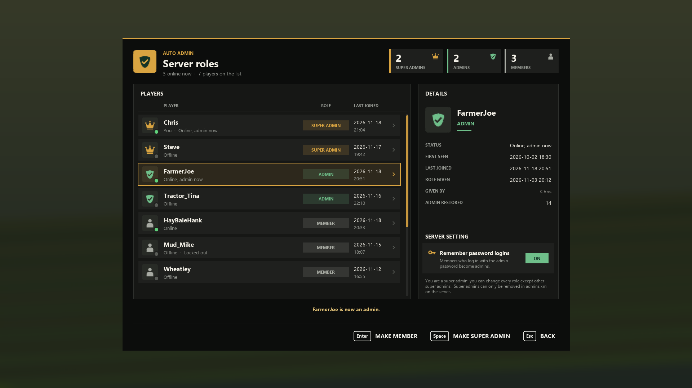

  

<h1 align="center">Auto Admin</h1>

  
  
  
  

  <b>The server remembers its admins and makes them admin again every time they join. No password saved anywhere.</b> 
  by Fennell

  

## Roles

| Role | Admin rights | Can be demoted in the game |
|------|--------------|----------------------------|
| **Super admin** | Yes, on every join | No. Only by editing the server's file |
| **Admin** | Yes, on every join | Yes, by a super admin, right away |
| **Member** | No | - |

Every player who joins the server is on the list, as a member until somebody promotes them.

## How players get a role

- **The first admin password login** on a server without a super admin makes that player the super admin.
  Install the mod, start the server and log in with the admin password yourself first.
- **The admin password** works as in the base game. A member who logs in with it becomes an admin
  (super admins can turn this off: "Remember password logins" in the admin screen).
- **A super admin** promotes and demotes players in the admin screen.
- **A demoted player is locked out:** if they log in with the admin password, it is undone a moment later.
  Promoting them again lifts that.

## The admin screen

**Left Alt + A** (change it under Settings > Controls). Admins can open it to look; only super admins change things.

- The player list: role, online or not, last joined. Super admins first, then admins, then members.
- Details of the selected player: first seen, last joined, when and by whom the role was given, how often their
  admin rights were restored on join.
- **Make admin / Make member / Make super admin** in the button bar (each asks first).
  Making someone super admin can't be undone in the game.
- **Remove from list** for offline members (they come back as members when they join again).
- **Remember password logins** on / off.

## Where the list is kept

On the server, in `<server profile>/modSettings/FS25_AutoAdmin/admins.xml`: names, unique user ids, roles and dates.
No passwords. To remove a super admin, stop the server, change their `role="superAdmin"` to `admin` or `member`
in that file, and start it again (the server rewrites the file on every change, so edits while it runs are lost).

## Install

Multiplayer only. Put `FS25_AutoAdmin.zip` on the server and on every player's game (as with every
multiplayer mod, everyone needs the same zip).

<b>For developers</b>

| File | What it is |
|------|------------|
| `scripts/AutoAdmin.lua` | The list, the server hooks (join, admin login), requests from the screen, client glue |
| `scripts/AutoAdminEvents.lua` | Network events: request, data, notice, revoke |
| `scripts/gui/AutoAdminDialog.lua`, `gui/AutoAdminDialog.xml` | The admin screen |
| `scripts/gui/AutoAdminGui.lua`, `gui/autoAdmin_ui.dds` | The GUI image sheet and colours |
| `tools/make_textures.py` | Draws the GUI sheet and the mod icon (Pillow) |
| `tools/preview_dialog.py` | Renders the admin screen from the XML with sample players (`previews/admin_screen.png`) |
| `tests/run.py` | Offline tests of the server logic (`pip install lupa`, then `python tests/run.py`) |

Game functions used (FS22 names, checked against FS25 mods where possible): `UserManager:addMasterUserByConnection`,
`addMasterUser`, `removeMasterUser`, `User:getIsMasterUser`, `FSBaseMission.onConnectionFinishedLoading`. The server
log prints which of them it found at start (`[AutoAdmin] server ready ...`).

